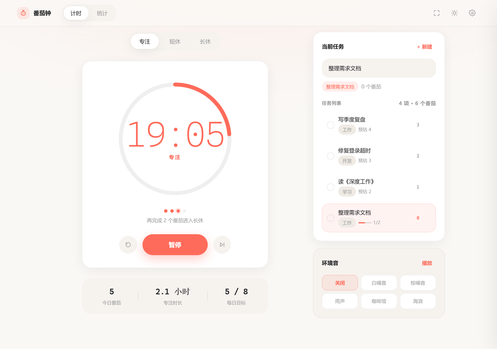
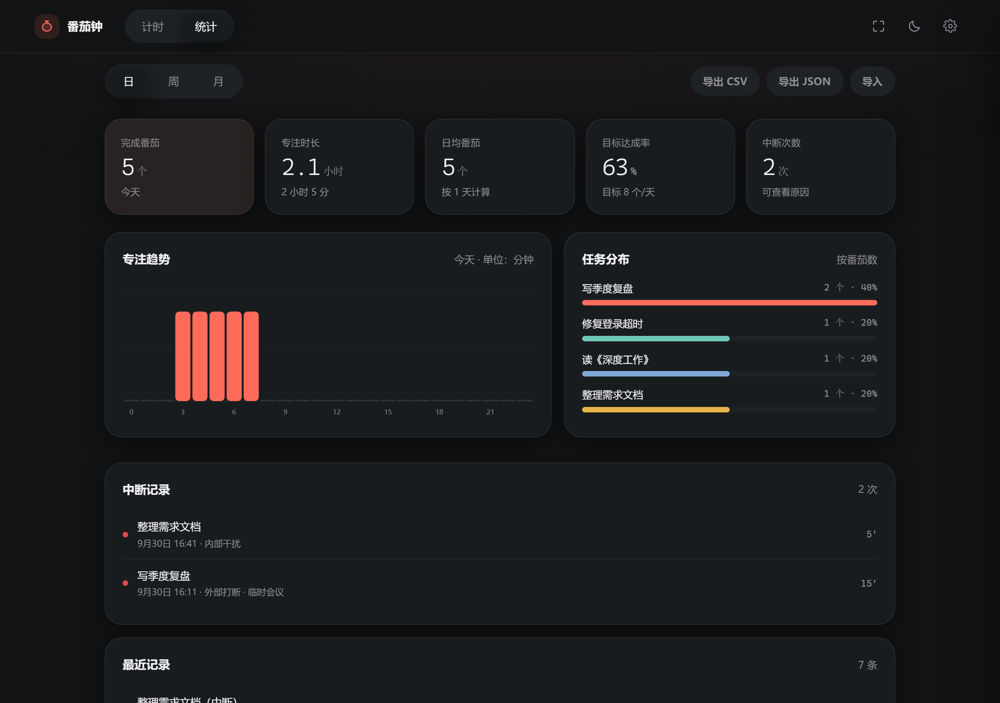
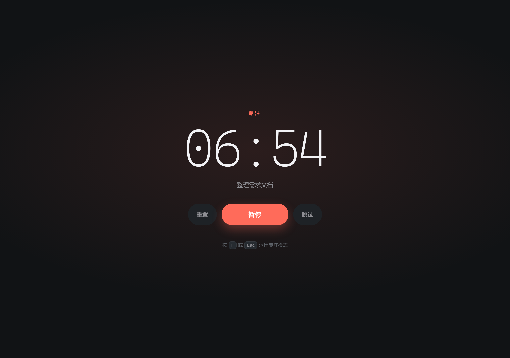
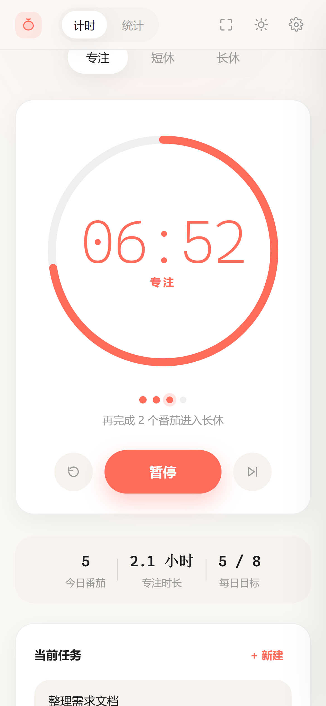

# 番茄钟 · Pomodoro

一套代码同时覆盖 **Windows 桌面端** 与 **Android**。核心是一个零依赖的 PWA，
Windows 上再套一层 Electron 外壳拿到原生托盘倒计时与任务栏进度。

```
用户选择/输入任务 → 25 分钟专注 → 提示音 + 系统通知 + 记录 1 个番茄
   → 5 分钟短休 → 每完成 4 个番茄进入 15–30 分钟长休 → 循环
```

---

## 界面预览

| 浅色 · 专注进行中 | 深色 · 统计 |
| :---: | :---: |
|  |  |
| 圆环进度、轮次圆点、任务列表与子任务进度 | 日 / 周 / 月统计、任务分布、中断记录 |

| 专注模式（`F`） | 手机端（Android PWA） |
| :---: | :---: |
|  |  |
| 全屏极简，只剩倒计时与任务名 | 同一套代码，响应式布局 |

---

## 快速开始

### Windows

**方式一：直接跑网页版（最快）**

```bash
cd pomodoro
npx --yes serve . -l 5173
# 浏览器打开 http://localhost:5173
```

用 Edge / Chrome 打开后，地址栏右侧会出现「安装」图标，装完就是一个独立窗口的桌面应用，
开始菜单可搜到「番茄钟」。

**方式二：Electron 桌面端（含系统托盘倒计时）**

```bash
cd pomodoro
npm install          # 首次需下载 Electron，约 100MB
npm start            # 开发模式启动
npm run dist         # 打包成 NSIS 安装包 + 免安装 exe，产物在 release/
```

桌面端额外获得：

- 系统托盘常驻，鼠标悬停显示 `番茄钟 · 专注 24:31（进行中）`
- 任务栏进度条随专注进度推进
- 托盘右键菜单：开始/暂停、跳过、重置、专注模式、退出
- 关闭窗口默认最小化到托盘，不退出
- 原生 Windows 通知（点击通知回到主窗口）

### Android

**方式一：PWA 安装（推荐，无需打包）**

把 `pomodoro/` 目录部署到任意 HTTPS 静态托管（内网也可用 `npx serve`），
手机 Chrome 打开 → 菜单 → **添加到主屏幕**。装完即为全屏独立应用，
支持离线使用、系统通知、深色模式。

**方式二：打包成 APK**

```bash
cd pomodoro
npm install
npx cap add android      # 生成 android/ 原生工程
npx cap sync android
npx cap open android     # 用 Android Studio 打开并构建 APK
```

`capacitor.config.json` 已按项目配色配置好（背景 `#FAF8F5`、通知色 `#FF6B5A`）。

---

## 功能清单

### MVP（全部已实现）

| 需求 | 实现 |
| --- | --- |
| 计时 | 时间戳驱动（`endAt - Date.now()`），标签页被节流或电脑休眠后回到前台自动校准 |
| 开始 / 暂停 / 继续 / 重置 / 跳过 | 主按钮切换开始·暂停·继续；重置归零当前阶段；跳过进入下一阶段 |
| 阶段切换 | 专注 / 短休 / 长休三个页签手动切换；自动切换由设置控制 |
| 结束提示音 | Web Audio 实时合成钟琴音色，**不依赖任何音频文件**；专注结束为下行两音，休息结束为上行三音 |
| 系统级通知 | Notification API（浏览器 / PWA）+ 原生通知（Electron） |
| 番茄计数 | 顶部轮次圆点显示当前第几个；今日完成数；「再完成 N 个番茄进入长休」 |
| 任务关联 | 输入任务名回车即开始专注；每个任务累计番茄数与专注时长 |
| 自定义时长 | 专注 / 短休 / 长休 / 长休间隔，均可改 |
| 自动开始下一阶段 | 休息自动开始、专注自动开始，两项独立开关 |
| 声音开关 | 提示音总开关 + 音量 + 最后 3 秒滴答 |
| 本地保存 | `localStorage` 全量持久化，关掉重开数据、进度、正在跑的计时全部恢复 |

### 进阶（全部已实现）

- **任务列表与子任务、标签**：任务可设标签、预估番茄数、子任务（带完成进度条）；同名任务自动复用
- **日 / 周 / 月统计**：番茄数、专注时长、日均番茄、目标达成率、中断次数；24 小时分布 / 7 天 / 30 天柱状图；任务分布条形图
- **深色模式与主题**：跟随系统 / 浅色 / 深色三态，一键切换
- **快捷键**：见下表
- **系统托盘 / 菜单栏倒计时**：Electron 托盘提示 + 任务栏进度条；macOS 菜单栏直接显示 `24:31`
- **白噪音与背景音**：白噪音、棕噪音、雨声、咖啡馆、海浪，全部由 Web Audio 实时合成（含 LFO 调制），零素材
- **暂停 / 中断原因记录**：专注超过 1 分钟后重置或跳过，弹窗记录原因（内部干扰 / 外部打断 / 任务切换 / 临时离开 / 状态不佳 / 其他）+ 备注，统计页可回顾
- **每日目标**：默认 8 个番茄，达成时额外播放庆祝音 + 通知
- **CSV / JSON 导出**：CSV 带 BOM，Excel 直接打开不乱码
- **跨设备同步**：导出 JSON → 另一台设备导入（详见下文「数据与同步」）
- **专注模式**：`F` 键进入全屏极简界面，只剩倒计时和任务名

---

## 快捷键

| 按键 | 作用 |
| --- | --- |
| `Space` | 开始 / 暂停 |
| `R` | 重置当前阶段 |
| `S` | 跳过当前阶段 |
| `F` | 专注模式（全屏） |
| `1` `2` `3` | 专注 / 短休 / 长休 |
| `T` | 计时 ⇄ 统计 |
| `N` | 新建任务 |
| `D` | 切换主题 |
| `,` | 打开设置 |
| `Esc` | 关闭浮层 |

---

## 设计规范落地

| 项 | 值 | 落地位置 |
| --- | --- | --- |
| 背景（浅色） | `#FAF8F5` | `--bg` |
| 背景（暗色） | `#111315` | `html[data-theme=dark] --bg` |
| 主色 番茄红 | `#FF6B5A` | `--tomato`，专注阶段强调色 |
| 短休 薄荷绿 | `#6FC7B6` | `--mint` |
| 长休 雾蓝 | `#7FA8D8` | `--mist` |
| 主文字 | `#1C1C1E` / 暗色 `#F2F2F5` | `--text` |
| 次要文字 | `#9A9A9A` | `--text-2` |
| 字体 | SF Pro / Inter / PingFang SC | `--font`（含 HarmonyOS Sans、微软雅黑兜底） |
| 倒计时 | 72–96px、字重 200、等宽、tabular-nums | `.time`：`clamp(72px, 13vw, 92px)` |
| 卡片圆角 | 20–24px | `--r-card: 24px` / `--r-panel: 22px` |
| 按钮 | 胶囊形 | `--r-pill: 999px` |
| 阴影 | `0 8px 30px rgba(0,0,0,.06)` | `--shadow`（暗色下加深） |

阶段切换时，整个页面的强调色、圆环、按钮、开关、图表配色都会跟着切换，
背景还有一层跟随阶段色的极淡径向光晕。

---

## 目录结构

```
pomodoro/
├── index.html              单页应用（计时 / 统计 / 设置 / 弹窗 / 专注模式）
├── styles.css              设计系统：配色、字体、圆角、阴影、响应式
├── manifest.webmanifest    PWA 清单（含快捷方式「开始专注」）
├── sw.js                   Service Worker，离线可用 + 通知点击聚焦
├── LICENSE                 MIT
├── js/
│   ├── store.js            状态、localStorage 持久化、迁移、日期与格式化工具
│   ├── audio.js            Web Audio 合成提示音与环境音
│   ├── timer.js            计时引擎：阶段流转、轮次、中断记录
│   ├── stats.js            统计聚合 + 手写 SVG 图表
│   └── app.js              界面装配与全部交互
├── icons/                  应用图标（含托盘图标，由脚本生成）
├── docs/                   README 用的界面截图
├── desktop/
│   ├── main.js             Electron 主进程：托盘、任务栏进度、原生通知
│   └── preload.js          contextBridge 安全桥
├── tools/
│   ├── make-icons.py       纯 Python 生成全部图标（无第三方依赖）
│   ├── test-engine.js      无头逻辑测试（55 项断言）
│   ├── check-dom.js        DOM 引用 / 静态资源一致性校验
│   ├── shoot.js            基于 CDP 的 13 场景渲染截图与运行时自检
│   └── diag.js             控制台异常诊断
└── capacitor.config.json   Android 打包配置
```

---

## 数据与同步

所有数据存在浏览器 / 应用本地的 `localStorage`，键名 `pomodoro.state.v1`。
包含设置、任务、记录、当前计时状态。**不上传任何服务器。**

- **备份**：设置 → 数据 → 导出 JSON，得到 `pomodoro-backup-YYYYMMDD.json`
- **迁移 / 多设备**：在另一台设备点「导入」选择该文件即可（导入后自动刷新）
- **手动同步**：把备份文件放进 OneDrive / 坚果云等同步目录，换设备时导入
- **表格分析**：导出 CSV（`日期,开始时间,结束时间,类型,任务,标签,时长,是否完成,中断原因,备注`）

记录上限 5000 条，超出后自动丢弃最旧的。

---

## 自测

```bash
# 逻辑测试：计时流转、轮次、中断、统计、持久化、边界（55 项断言）
node tools/test-engine.js

# DOM 引用与静态资源一致性
node tools/check-dom.js

# 需要先起本地服务：npx serve . -l 5173
node tools/shoot.js         # 13 个场景渲染截图 + 运行时自检，产物在 .shots/
```

`tools/shoot.js` 会自动校验：圆角 = 22px、阴影 = `rgba(0,0,0,0.06) 0 8px 30px`、
背景 = `#FAF8F5`、圆环 dashoffset 随进度更新、页面内零 JS 异常。

它会自动探测 Chrome / Edge 的安装位置（Windows / macOS / Linux 都支持）。
如果装在非标准路径，用环境变量指定：

```bash
CHROME_PATH="/path/to/chrome" POMODORO_URL="http://127.0.0.1:5173/index.html" node tools/shoot.js
```

---

## 已知边界

- **跨设备同步是文件式的**，没有账号体系与实时同步。要做到自动同步需要自建后端
  （数据库 + 用户认证 + 同步接口）。
- **浏览器端的系统通知**需要 HTTPS（`localhost` 除外）且用户授权；HTTP 页面下会静默降级。
- **浏览器后台节流**：页面被完全隐藏时定时器精度会下降，但所有计算基于时间戳，
  回到前台会立即校准并补记完成记录。电脑休眠超过 5 分钟则不自动续接下一阶段，避免误记。
- **Web Audio 需要一次用户手势**才能出声，这是浏览器策略，首次点击任意处即解锁。

---

## 许可

[MIT](LICENSE) © 2026 Moyuan
